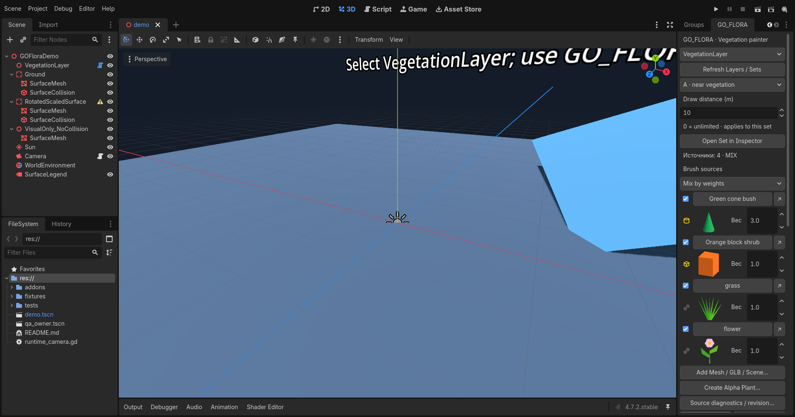
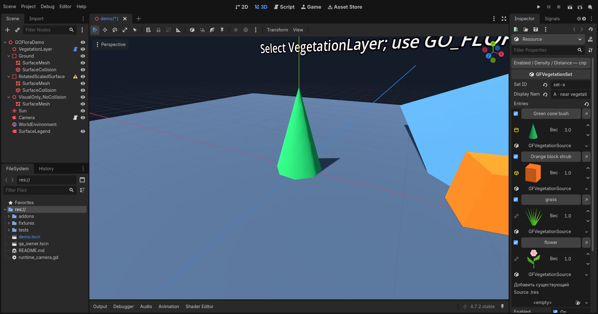

# GO_FLORA — Stage 02.1: Palette & Dock UX

**0.2.1-dev · READY_FOR_MANUAL_QA · INTERACTIVE_GUI_QA: NOT_RUN.** Выполнен [Issue #7](https://github.com/alekseypilishkov-gif/go_flora/issues/7) в той же ветке `codex/stage-02-imported-alpha`, для обновления существующего [Draft PR #6](https://github.com/alekseypilishkov-gif/go_flora/pull/6). Исходная точка обновления: `875e2ea6e587111a1476f17bbbeca1d18f5bdc99`, актуальная на момент назначения/начала работы. Stage 03, merge и release не выполнялись.

## Что изменилось

1. Новый default dock — **справа рядом с Inspector**, минимальный размер 260×120. Длинные имена/статусы и 24 источника не меняют ширину. Сохранённый layout не сбрасывается; если Godot восстановил старое левое положение, один раз перенесите вкладку. Ctrl+Alt+G показывает GO_FLORA.
2. Вместо безымянных GFPaletteEntry — **именованные строки в dock и Inspector**: Green cone bush, Orange block shrub, grass, flower, preview, тип/ID в tooltip, флажок, вес и ↗ для Source Inspector. Используется официальный EditorInspectorPlugin/EditorProperty; остальные поля набора остаются нативными. `resource_name` не меняется.
3. **Brush sources: Mix by weights / Selected source only**. Нажатие названия/preview выбирает растение для новых Paint/Single. Возврат MIX сохраняет исходные веса/состав. Single по-прежнему создаёт ровно одну запись и не означает выбор растения.
4. Флажок `GFPaletteEntry.enabled=true` добавлен совместимо: старые сцены автоматически включены. Off исключает источник из новых размещений, сохраняя вес и все старые растения. MIX исключает off/вес 0; Selected требует включённый валидный источник и игнорирует MIX-вес, в том числе 0. Нет допустимого источника — понятная диагностика, без случайного fallback. Erase остаётся доступным.
5. Enabled/weight/ссылки и добавление существующего Source используют историю сцены Undo/Redo. Выбор источника/режима — временное состояние кисти. **Записи, IDs, positions/transforms, RNG, enum и schema 1 не меняются**, миграция сцен не требуется. Существующие сцены/fixtures оставлены как есть.
6. Open Set in Inspector выбирает активный набор и показывает вкладку. Runtime проверка выявила: одного inspect_object в 4.7.2 недостаточно при скрытой вкладке. После него применяется официальный EditorDock.make_visible() к найденному по публичному типу предку get_inspector(); нет фиксированных путей/индексов или записи layout. Проверены выбор другого узла/набора/сцены и disable/enable плагина.
7. Русские hover-подсказки на основных полях кисти, палитры, Draw Distance и Alpha Plant; подсказки есть и у внутренних LineEdit числовых полей. Help / Справка открывает легенду по клику; Inspector имеет помощь Enabled/Density/Distance. Единицы/defaults объяснены, постоянно раскрытый длинный help убран.

[Подробные совместимые контракты](../../../../docs/STAGE_02_1_PALETTE_UX.md), [инструкция плагина](../../../../addons/go_flora/README.md), [чек-лист ручной приёмки](manual_qa.md).

## Проверки

Точный engine: `4.7.2.stable.official.ed1daf0bf`; локальный executable SHA-256 `ab1824f85bfd8e0e4128182c000c4003a3e042245b2967848d089b2a04b22424`. Исходные документы API, результаты headless, native Editor API, GPU pixels и неизвестное/непроверенное различаются. [Индекс всех запусков](evidence/run_index.json), [итоговая сводка](evidence/results.json), [описание evidence и команд](evidence/README.md).

| Проверка | Результат |
| --- | --- |
| Baseline до изменений: Stage 01 core / native Editor API | PASS: 45 / 27 |
| Baseline до изменений: Stage 02 core / native Editor API | PASS: 87 / 62 |
| Финальный Stage 01 core / native Editor API, save + fresh-process reopen | PASS: 45 / 27 |
| Финальный Stage 02 core / native Editor API, save + fresh-process reopen | PASS: 87 / 62 |
| Новые UX core + fresh-process reopen | PASS: 28 + отдельный процесс |
| Новые UX native Editor API, headless | PASS: 99 |
| Те же UX native API на настоящем GPU + 2 снимка редактора | PASS: 101; это НЕ мышиная GUI QA |
| Alpha-scissor PNG/WebP × 3/12/24 м × Compatibility/Mobile/Forward+ | PASS: 18 GPU pixel probes, NVIDIA RTX 5060 Ti |
| Plugin-only ZIP, CRC/SHA, побайтовая воспроизводимость | PASS: 51 файл, без моделей/текстур/сцен/зависимостей |
| Три установки ZIP в одноразовый проект, Stage 01/02 сцены + config/layout SHA | PASS; backups сохранены |
| Чистый import ZIP, Stage 01/02 runtime smoke | PASS |
| Реальные мышь, drag/navigation, ручное сохранение/перезапуск редактора | **NOT_RUN**, требуется владелец |

87/62 функциональные проверки Stage 02 сохранены. В старом 27-case Editor harness изменено **только ожидание default tab group** с Scene/Import на Inspector согласно Issue #7; assertions ширины/минимума/истории не ослаблялись. Реальный GLB import/reimport, PNG/WebP, authored fallback, multi-part batches, Paint/Erase/Single, Undo/Redo, Draw Distance и frozen Stage 01 records повторно прошли.

Неуспешные попытки сохранены рядом с успешными. Начальные ошибки нового тестового стенда (типизация GDScript, void save_scene_as, сравнение разных stroke serial, неправильный прямой parent вкладки) исправлены. Реальный отказ фокуса Inspector исправлен публичным API. Первый Forward+ запуск дал FAIL из-за слишком длинного Windows shader-cache path; повтор с коротким изолированным `.scratch/gpu-profiles/` прошёл без ошибок, pixel criteria не менялись. Capture скрытого idle editor первоначально ждал отсутствующий frame_post_draw и был завершён по timeout; явный RenderingServer.force_draw исправил только capture стенд.

## ZIP и установка владельцем

Архив: `GO_FLORA_stage02_0.2.1-dev_b4347c96.zip`, локально в `stages/02_imported_alpha_vegetation/updates/01_palette_dock_ux/.scratch/packages/`. SHA-256: `66f987e02d60fc02e618ecfe08915b678468b5b4bf3d2795436a630ac9fc5832`. [Manifest с SHA каждого файла](evidence/package_manifest.json). ZIP хранится в ignored .scratch, не публикуется как release; CI также выдаёт plugin ZIP artifact.

Сохраните сцены и закройте Godot, затем распакуйте только addons/go_flora в выбранный проект с резервной копией старого addon. Optional [tools/install_stage02.py](../../../../tools/install_stage02.py) проверяет manifest/CRC/SHA/пути, сохраняет addon backup и не записывает сцены/project.godot/.godot editor layout. Для него нужны ZIP и соседний JSON manifest. Это отдельная команда владельца; **C:\Dev\TEST_FLORA агент не читал и не изменял, ZIP туда не устанавливал**. Отдельный Blender GAME_FLORA не затрагивался. Новые сторонние assets/код не добавлялись; исходные MIT fixtures повторно использованы только в тестах.

Quality/CI факты и ссылки: [quality gates](evidence/quality_gates.json), [CI summary](evidence/ci_summary.json). Изменения задачи будут committed/pushed в тот же Draft PR #6. Полностью пустой `git status` невозможен без вмешательства в ранее существовавший пользовательский untracked WebP: этот файл сохранён вне коммита. Отдельно проверяется отсутствие tracked/staged изменений задачи.

После автоматических проверок работа останавливается на **READY_FOR_MANUAL_QA**. Приёмку по checklist выполняет владелец; PR остаётся Draft, слияние/релиз/Stage 03 не выполняются.
