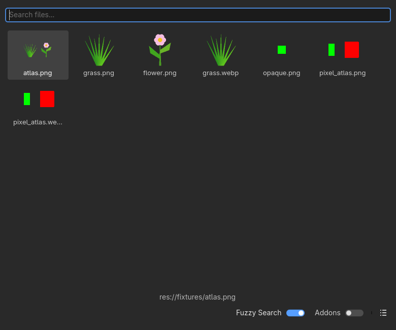
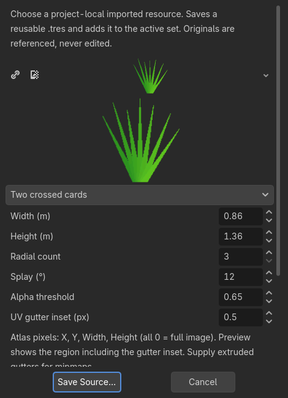
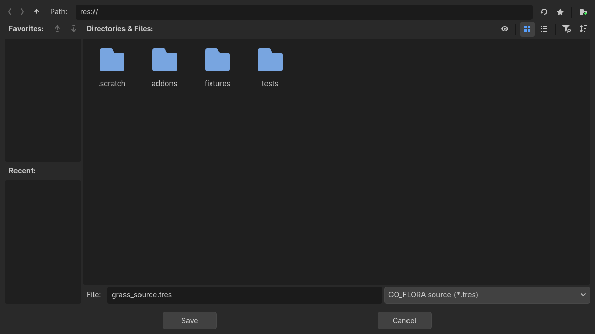

# GO_FLORA Stage 02.2 — Resource Picker Modal Fix

**0.2.2-dev · READY_FOR_MANUAL_QA · INTERACTIVE_GUI_QA: NOT_RUN.** Выполнен [Issue #8](https://github.com/alekseypilishkov-gif/go_flora/issues/8) в существующей ветке `codex/stage-02-imported-alpha`, для того же [Draft PR #6](https://github.com/alekseypilishkov-gif/go_flora/pull/6). Исходный HEAD `1c61bf1fcd059cfb4d559eeabac806c684ecfddb` проверен fetch перед работой. Нет merge, release или Stage 03.

## Подтверждённая ошибка и исправление

**OWNER_REPORTED_GUI_FAIL, 0.2.1-dev:** выбор PNG через Create Alpha Plant → штатный Quick Load вызывал `Attempting to make child window exclusive, but the parent window already has another exclusive child` в `scene/main/window.cpp:1160`. Исходное сообщение владельца сохранено в [Issue snapshot](evidence/issue_08.json). Оно не доказывает сбой PNG parser или потерю logical records.

Ошибка отдельно воспроизведена через **настоящий EditorResourcePicker → его нативное меню → Quick Load**, сначала headless, затем на GPU с Windows-окнами (`embedded=false`). В обоих случаях старый ConfirmationDialog был `exclusive=true`, а EditorQuickOpenDialog пытался занять тот же root-exclusive slot. Старый addon восстановлен побайтово из указанного Git SHA **только в новом disposable проекте**. Это native API reproduction, не физическая мышь. [Логи до исправления на GPU](evidence/runs/repro-gpu-1792051886684400200/editor_modal_harness.log).

Исправление ограничено editor-кодом:

- Creator остаётся ConfirmationDialog с прежними controls/tooltips, но как editor-owned инструмент имеет **exclusive=false, transient=true**. Штатные Quick Load/Load не заменены и сохраняют свою модальность.
- Save Source скрывает черновик и открывает **отдельный editor-owned EditorFileDialog**, а не конкурирующий popup внутри creator. Повторное нажатие Save не открывает второй диалог. Cancel Save освобождает модальный слот и возвращает тот же черновик/Source ID/настройки; Cancel/X/Escape creator отменяют операцию.
- Явная очистка освобождает собственный Save и окна внутри creator. Для shared Quick Open запоминается окно, открытое действием **собственного** picker: наблюдаются публичные сигналы его controls, затем Node.get_last_exclusive_window(). При отмене вызывается штатный close-request и hide только этого окна. Нет фиксированных menu IDs, путей/имён внутренних узлов, подмены native handlers или обхода всего editor tree в коде плагина. Чужое modal окно не закрывается; глобальные exclusive flags не меняются.
- Смена слоя/набора/сцены, Help/diagnostics и disable plugin завершают черновик. Save callback защищён от повторного выполнения, source_saved подключён one-shot, palette append дополнительно отсекает повторный source_id. Успешное сохранение — один native scene Undo шаг, Redo возвращает тот же источник.
- На время операции фоновые viewport events поглощаются, pending stroke отменяется. После закрытия доступна прежняя кисть/навигация. Help/diagnostics по-прежнему эксклюзивны и заменяют свои предыдущие окна.

**ADR 0001 сохранён:** editor-only hotfix, без новых зависимостей, провайдеров, изменений core/data/rendering, схемы 1, ID/RNG/placement semantics или существующих сцен. Палитра Mix/Selected, enabled/weight, Draw Distance, русский help и правый Inspector dock версии 0.2.1-dev сохранены. Старые stage evidence/fixtures не переписаны; в родительском Stage 02 report добавлена только ссылка сюда. Сторонние assets/код не добавлялись, ZIP содержит только оригинальный MIT addon.

## Автоматические проверки

Engine **4.7.2.stable.official.ed1daf0bf**, Windows executable SHA-256 `ab1824f85bfd8e0e4128182c000c4003a3e042245b2967848d089b2a04b22424`. API/source evidence: [Window](https://docs.godotengine.org/en/4.7/classes/class_window.html), [EditorResourcePicker](https://docs.godotengine.org/en/4.7/classes/class_editorresourcepicker.html), [pinned window.cpp](https://github.com/godotengine/godot/blob/ed1daf0bf/scene/main/window.cpp), [pinned dialogs.cpp](https://github.com/godotengine/godot/blob/ed1daf0bf/scene/gui/dialogs.cpp). Эти источники объясняют механизм; runtime PASS подтверждается отдельными выполненными probes.

| Проверка | Результат |
| --- | --- |
| 0.2.1-dev Quick Load, headless и реальные Windows-окна через API | **FAIL reproduced**, reproduction probe PASS |
| Новая матрица 6 assets × Quick Load/Load → Save/Cancel/Undo/Redo | PASS; реальные native обработчики, поиск/выбор строки/подтверждение, без прямой подстановки texture в source |
| Новый headless Editor API suite | **PASS: 274 assertions** |
| Тот же suite на RTX 5060 Ti с Windows-окнами + 3 кадра их viewport | **PASS: 277 assertions** |
| Новый save/reopen в отдельном процессе | PASS: 12 .tres, unique IDs, texture/model refs, dimensions, 14 palette entries, прежние records/transforms/normals/revisions и schema 1; UV отдельно проверен reload .tres после Save |
| Stage 01 core + native Editor API + fresh-process reopen | **PASS: 45 + 27**, прежние cases неизменны |
| Stage 02 core + native Editor API + fresh-process reopen | **PASS: 87 + 62**, прежние cases неизменны |
| Stage 02.1 core + native Editor API + fresh-process reopen | **PASS: 28 + 99**, прежние cases неизменны |
| Alpha-scissor PNG/WebP × 3/12/24 м × Compatibility/Mobile/Forward+ | **PASS: 18 GPU pixel probes** |
| ZIP CRC/every-file SHA, повторная побайтовая сборка | PASS: 53 addon files |
| Три установки в disposable проект, SHA Stage 01/02 сцен + project.godot + layout | PASS; backups сохранены; clean import и runtime smoke PASS |
| Физические мышь/клавиатура, drag/navigation/manual save в проекте владельца | **NOT_RUN**, нужна ручная повторная приёмка |

Новые tests охватывают grass.png, flower.png, lossless grass.webp, atlas.png, настоящий original_plant.glb и static_plant.tscn обоими штатными chooser путями. Проверены доступность native Open/Save buttons, сохранение ALPHA_CARD/dimensions/splay/threshold/atlas, повторные открытия, Cancel/X/инжектированный Escape с правильным window_id, возврат из Cancel Save, один append/undo/redo, duplicate callback, переключение набора с открытым Quick Open, Help/diagnostics, сохранение/disable с открытым Save, reenable, scene switch, отсутствие orphan Save окон, Paint/Erase/Single после создания. Opaque PNG диагностируется и блокирует Save; authored PackedScene остаётся unsupported до review и не flatten автоматически. Чужой модальный диалог сохраняется при закрытии creator.

Все попытки, включая FAIL тестового стенда, сохранены: [run index](evidence/run_index.json), [итоги](evidence/results.json), [команды и raw logs](evidence/README.md). Исправлены ошибки стенда: типизация GDScript; фактический базовый класс Quick Open — AcceptDialog; quantization SpinBox от min=0.01; UID priming рукописных .tscn только в disposable copy; корректная очистка EditorUndoRedoManager; opaque fixture создаётся в копии. Для GPU Escape адресуется native window_id, а не root ID; Load выбирает реальную строку ItemList, поскольку current_path сам по себе не выделяет файл. Кадры получают из viewport нужного окна после layout/redraw; ранние root-only captures не считались визуальной приёмкой. Engine errors в исправленных probes не подавляются.

## ZIP и ручная установка

Архив **GO_FLORA_stage02_0.2.2-dev_0b52bc6d.zip**. Полный локальный путь:

`C:\Dev\GO_FLORA\stages\02_imported_alpha_vegetation\updates\02_resource_picker_modal_fix\.scratch\packages\GO_FLORA_stage02_0.2.2-dev_0b52bc6d.zip`

SHA-256: `2cc3e987af9c8c1fdeef10b1815defaba933173ac0f24157390b3de125e0f059`. Рядом находятся JSON manifest и .sha256; [копия manifest с SHA каждого файла](evidence/package_manifest.json). ZIP-only dev build, не release; модели/текстуры/сцены/зависимости в него не входят.

Установку выполняет владелец **через Проводник Windows**: сохранить сцены, закрыть Godot, сделать backup прежнего addon **вне TEST_FLORA**, «Извлечь всё» во временную папку, затем скопировать извлечённую `addons\go_flora` в **`C:\Dev\TEST_FLORA\addons\go_flora`**. Итоговый plugin.cfg должен лежать непосредственно в этой папке, без двойного уровня addons. [Подробные шаги установки и GUI re-test](manual_qa.md). PowerShell для владельца не требуется. Агент TEST_FLORA и Blender GAME_FLORA не читал, не изменял и ZIP туда не устанавливал.

[Source commit c0fd5a5323b203cd8666156ef59076688da18281](https://github.com/alekseypilishkov-gif/go_flora/commit/c0fd5a5323b203cd8666156ef59076688da18281) отправлен в ту же ветку. На нём **PASS все три GitHub Actions**: [repository static](https://github.com/alekseypilishkov-gif/go_flora/actions/runs/38706448844), [Stage 01](https://github.com/alekseypilishkov-gif/go_flora/actions/runs/38706448833), [Stage 02, включая 02.1/02.2 и ZIP](https://github.com/alekseypilishkov-gif/go_flora/actions/runs/38706448831). [CI metadata/artifact digest](evidence/ci_summary.json). ZIP пересобран после source commit: SHA не изменился, все 53 Git blobs совпадают с manifest.

[Quality gates](evidence/quality_gates.json): repository validation, working/staged/PR-base whitespace, неизменность прежних stage evidence/scenes/tests/ADR, core/data/rendering, SHA runtime GDScript в финальных headless/GPU/regression копиях — **PASS**. Tracked/staged status после source commit чист. Полностью пустой git status — **FAIL** только из-за прежнего пользовательского untracked WebP, сохранённого вне коммитов. [Первичная сборка отчёта](evidence/quality_gates_preliminary.json) сохраняет FAIL двух тогда ещё отсутствовавших ссылок quality/CI; после создания файлов validator PASS. Последующий коммит дополняет только отчёт/evidence; проверки его конечного HEAD фиксируются отдельно в PR #6.

Остановиться для ручной приёмки владельца. **PR #6 остаётся Draft; merge/release/Stage 03 не выполняются.**
